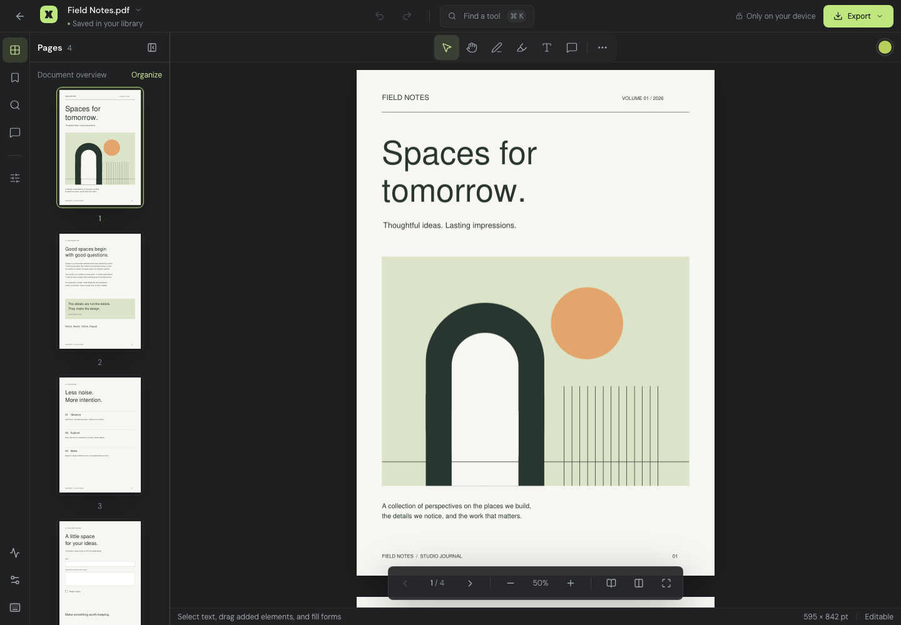

# PDFWeld

A private, canvas-first PDF studio for desktop and phone. React + TypeScript + Tailwind utilities, with the MuPDF WASM engine isolated in a Web Worker. No application backend, accounts, analytics, document uploads, remote fonts, or third-party processing calls.

## Run locally — one command

Requires Node.js 22.12 or newer.

```sh
npm start
```

On a fresh checkout this installs the locked dependencies and starts Vite. Open http://localhost:5173 . The terminal also prints the LAN address for testing on a phone on the same Wi-Fi. PWA installation and some browser APIs require HTTPS or localhost; use a deployed HTTPS URL for installation testing on a phone.

The bundled **Field Notes** document contains four designed pages, real text, bookmarks, and interactive form fields. Open it from the gallery to explore the application.

## Deploy to GitHub Pages — one command

With an existing GitHub repository configured as `origin` and Git push authentication configured:

```sh
npm run deploy
```

Alternatively, provide the repository directly:

```sh
npm run deploy -- https://github.com/YOUR-NAME/YOUR-REPO.git
```

This builds the static application, publishes `dist/` to `gh-pages`, and, when GitHub CLI is installed and signed in, configures Pages to serve that branch. Without GitHub CLI, select **Settings → Pages → Deploy from a branch → gh-pages / root** once. Repository creation, authentication, and permission to enable Pages are one-time prerequisites. The script does not create repositories or change access policies.

A separate `.github/workflows/pages.yml` supports deployment through GitHub Actions. Choose one deployment method; branch publishing and the Pages Actions source setting should not be mixed. All asset paths are relative, so both `username.github.io/repository/` and a custom domain work.

## Working features

### Start from Home

Home offers **Edit PDF, Compress PDF, Combine files, Fill & sign, Organize pages, and Images to PDF** before you open a document. **All tools** is a searchable catalogue with category filters and 21 supported tools. You can also launch them from the home command palette (Cmd/Ctrl K).

Compress, Combine, Split, Extract, Rotate, image/text conversion, protection, watermarks, page numbering, sanitizing, flattening, certificate signing, and text comparison use dedicated file-processing workspaces. Add files from disk, drop them onto the workspace, or choose a saved library document. Process batches, download individual results or a ZIP, and optionally open a result in the editor. Combine supports PDF/PNG/JPEG inputs, keyboard-accessible file ordering, selected page ranges per PDF, and source bookmarks. Password prompts stay inside the workflow. Original files are unchanged. Compression is lossless; already-optimized documents can show 0% reduction.

Fill & sign starts with file selection, then opens a focused workspace with form fields, added text, drawn/uploaded signatures, and a direct save button. It jumps to the first page with form fields. Editing, page organization, cropping, redaction, and OCR similarly open the selected document directly in the appropriate interactive tool. File-processing work runs in a disposable Web Worker and can be cancelled. Desktop options panes resize with the same controls as editor panes; phones use a stacked layout.

This follows PDFCraft’s tool-first navigation: its [home recommendations](https://github.com/storytold/pdfcraft/blob/main/crates/ui-egui/src/home.rs) and [searchable tool catalogue](https://github.com/storytold/pdfcraft/blob/main/crates/ui-egui/src/panels/all_tools_ui.rs) launch tools, while its [Combine workflow](https://github.com/storytold/pdfcraft/blob/main/crates/ui-egui/src/workflows/combine_ui.rs) manages source files without an active editor document. PDFWeld implements this pattern as static browser UI and local WASM workers.

### Inside the editor

- Local library with IndexedDB recovery copies; document import, drag-and-drop, blank documents, image-to-PDF creation, renaming, export, and recovery across reloads.
- Continuous, single-page, and facing-page viewing; page thumbnails, deep zoom with visible tiles, pinch zoom, pan, selectable text, safe external links, and bookmarks.
- Whole-document text search with results and page highlights.
- Ink, drawn or uploaded signatures (PNG/JPEG, with PNG transparency and image proportions preserved), text highlighting, underline, strikethrough, notes, threaded replies, transparent text boxes, rectangles, ellipses, lines, arrows, review stamps, image stamps, and annotation removal/restyling. Open **Signature** in the annotation tools or command palette to draw or upload; then tap the page to place an image, or drag to choose its size.
- Text replacement: select an existing line, remove its original text, and replace it using Helvetica. Original complex typography and paragraph reflow are not preserved.
- Move added text, uploaded images/signatures, and drawn ink/signatures with **Select (V)**: tap an element and drag it, or use arrow keys (Shift for 10-point steps). The corner handle resizes it, preserving image/ink proportions; the floating controls edit or delete it. New text and image elements enter selection automatically. A drag commits one undoable PDF change on release; export preserves its placement.
- Organize, rotate, reorder, duplicate, insert, delete, merge, extract, and split pages. Page copying explicitly rebuilds widget/field ancestry, copies annotations and compatible links, and carries optional-content configuration. Merge/extract preserve attachments and selected bookmarks. Field-name collisions are disambiguated.
- Form filling, checkbox/radio toggles, choice fields, new text fields, reset forms, and optional flattening. Existing fields remain interactive on normal export.
- Crop pages, watermarks, page numbers, page-label prefixes, document metadata, optional-content layers, and attachment management.
- True applied redaction through MuPDF, followed by full rewritten export with garbage collection. The app does not use a black rectangle as a substitute for removing content. Save an original copy before redacting. Metadata and other occurrences elsewhere are separate from a selected redaction.
- Local PKCS#12/PFX certificate signing of an exported copy, using a basic invisible digital signature. No timestamp, chain-fetch, or revocation services are contacted. Encrypted and already-signed source documents are rejected by this signing workflow.
- AES-256 password-protected export; PDF permission checks for editing, annotation, copying, and printing.
- Stream/font/image compression without lossy image downsampling; PDF, PNG, JPEG, SVG, plain text, HTML, and structured-text JSON export; multi-file ZIP downloads.
- English OCR on selected pages through a local Tesseract worker and bundled model, producing an invisible searchable text layer while preserving the page image. Runtime/model downloads come from the same deployed site and are cached on demand.
- Extracted-text document comparison and structural document diagnostics.
- Keyboard shortcuts, command palette, keyboard-accessible dialogs with focus containment, mobile bottom sheets, safe-area layout, installed PWA, and cached offline reopening.

## Explicit boundaries

This implementation is not complete Acrobat offline parity. Features that remain outside this build include Office-document import and high-fidelity Word/Excel/PowerPoint export, arbitrary original-font paragraph editing/reflow, certificate validation and hardware signing tokens, full XFA, certified PDF/A/X/UA conversion/preflight, accessibility tag-tree authoring, professional separations/color-management controls, and desktop CLI/MCP or native printer integrations. Drawn signatures are annotations. The separate certificate-signing export embeds a cryptographic signature; reader trust depends on the certificate. Editing or rewriting a previously signed PDF can invalidate its existing signatures. Comparison currently checks extracted text, not pixel/layout differences. OCR is English/Latin text; it does not provide multilingual recognition.

The document checker reports structural observations and missing tags/fonts. It is not a standards-conformance certificate. Sanitizing removes metadata, document-level actions/JavaScript, and attachments; it does not certify removal of every possible hidden-data type. Embedded document JavaScript is disabled.

Browser recovery storage is not a substitute for exported backups: quota limits, private browsing, clearing site data, or OS eviction can remove it. Downloads are the baseline save mechanism on all supported browsers. Mobile printing uses the system PDF/share workflow where iframe printing is unavailable.

## Performance architecture and benchmarks

The target is **120 FPS on capable hardware**. The app does not fabricate frame counts, force synthetic refresh rates, or label a 60 Hz run as 120 FPS.

- PDF parsing, rendering, mutation, compression, and text extraction run in a worker.
- A priority queue serializes render jobs, prioritizes visible pages/tiles, deduplicates requests, and drops obsolete work.
- ImageBitmap transfer is used where supported, with transferable RGBA buffers as the fallback.
- Page canvases and text/form overlays are activated near the viewport. Offscreen page and ink canvases are released. The temporary live-ink preview is capped at 2.5 million pixels even at deep zoom; committed strokes are rendered at tile resolution. Deep zoom uses visible 768-pixel tiles instead of giant page buffers.
- Render-cache accounting is capped at 48 MiB; a full-page preview is capped at 2.5 million pixels. PDF worker memory, browser backing stores, document bytes, and active canvases are additional memory consumers.
- Export and recovery serialization optimize a disposable PDF snapshot, preserving the live undo journal.
- Pointer samples and live ink avoid React state updates. Coalesced samples are painted incrementally on animation frames; final strokes become actual PDF annotations.
- Pinch/wheel zoom immediately transforms cached content, then requests sharper output after the gesture.
- Fonts are self-hosted. OCR and pdf-lib creation tools are loaded on demand. Service workers cache the app shell and engine; OCR models are fetched only when used.

Run the browser benchmark matrix:

```sh
npm run benchmark
```

Install browser binaries once if necessary: `npx playwright install chromium firefox webkit`.

Use `npm run benchmark -- --quick --headed --require-120` to measure a visible desktop browser on a high-refresh display. No synthetic frame-rate flags are used.

For a quick desktop run: `npm run benchmark -- --quick`. To make a genuine 120 FPS presentation result mandatory: `npm run benchmark -- --require-120` (this correctly fails on a 60 Hz session).

To rerun one profile, use `npm run benchmark -- --profile=desktop-firefox` (also `desktop-chromium`, `mobile-chromium`, or `mobile-webkit`). This writes a separate profile report. Native file inputs are used for Home benchmarks, avoiding test-driver base64 decoding overhead while retaining measurement of the app's file reads and worker transfers.

Reports are written to `reports/performance.json`. Retained `reports/baseline.json` contains the pre-optimization desktop result. Scenarios cover the sample, a real 100-page PDF, and an eight-page 200-DPI scanned-document fixture on desktop Chromium/Firefox and touch/mobile Chromium/WebKit profiles. Each result records frame p50/p95/p99, actual browser cadence, dropped frames relative to that cadence, long tasks, PDF render latency, pointer-handler CPU time, cache use, browser identity, viewport, and document-open time. A mobile profile emulates viewport, pixel density, and input; it is **not** a physical phone performance measurement. Frame intervals do not measure GPU execution time; handler timings do not measure pen-to-photon latency.

The same command also benchmarks Home workflows on each profile: compressing an eight-page scan, combining four scanned PDFs, and splitting a 100-page PDF into ten files followed by a worker-generated ZIP download. The `homeTools` report includes inspection/processing/ZIP timings, frame cadence, long tasks, output counts, and confirmation that the editor stayed closed. Performance and correctness budget failures produce a nonzero exit status. The optional `--require-120` check applies to both editor and Home scenarios.

The in-app **Performance lab** also runs a document benchmark or records manual drawing/zooming. Download the JSON to compare physical devices. A 120 Hz device run is still needed before asserting 120 FPS on that device. Browser and OS scheduling may cap a session below its panel refresh rate.

The retained full run covers 12 editor document/profile combinations and 12 Home tool cases. All Home budgets passed, with zero recorded main-thread long tasks in Chromium; Firefox/WebKit do not expose that API. Editor input, committed-ink, cache, and error budgets passed. Two Firefox editor frame-cadence budgets failed during a run with heavy background system CPU use; those failures remain in `reports/performance.json`. Observed browser cadence varied from about 54–100 FPS. These measurements do not establish 120 FPS on physical devices.

The targeted Firefox rerun in `reports/performance-desktop-firefox.json` passed all editor and Home budgets at about 60 FPS. The full-run failures are retained to show the variation between sessions.

## Compatibility

`npm run browser-coverage` computes the estimated global usage covered by the configured browser-version targets and records the database version in `reports/browser-coverage.json`. The current estimate exceeds 95%; this is a usage estimate, not a claim that every browser/device combination has passed testing.

Targets include Chrome/Edge 90+, Firefox 114+, Safari/iOS 15.4+, Samsung Internet 16+, and modern Android browsers. The UI includes legacy/polyfill output, but WASM, ES modules, module workers, ResizeObserver, IntersectionObserver, and IndexedDB are the baseline. IndexedDB failure disables recovery without preventing document editing. New browser releases and regional/device distributions can change the usage estimate.

Use real phones for final validation of stylus behavior, memory pressure, keyboards, downloads/sharing, installation, and sustained frame cadence.

## Verification

```sh
npm test
```

Runs engine round-trip tests, a production build, installs the test browser binaries if needed, and runs the browser suite. `npm run test:unit`, `npm run test:e2e`, and `npm run check` are available separately. CI runs all three browser engines on Linux. `npm run verify:deploy` also checks a production build under a GitHub Pages-style `/pdfweld/` subpath. The UI tests include desktop/phone flows, annotations, undo/redo, real PDF downloads, form round trips, search/organization, offline reopening, certificate signing on all desktop engines, and one full local OCR pipeline. Independent CMS verification uses OpenSSL when available. The bundled P12 certificate is a public synthetic test fixture (password `pdfweld-test`), never a production signing identity. External processing requests are checked in those flows.

On macOS 27, Playwright's Firefox can fail because its default shared application-data folder is OS-protected (upstream issue microsoft/playwright#42768). The test/benchmark launch helper gives only the disposable test browser a private app-data home. It does not request Full Disk Access, read a personal Firefox profile, or alter browser security settings.

## Source and licensing

AGPL-3.0. MuPDF is AGPL/commercial dual-licensed; this application uses its AGPL option. Every production build includes `source.zip`, `LICENSE.txt`, and third-party notices. See `THIRD_PARTY_NOTICES.md`. The source archive excludes dependency binaries and model data; `npm ci` and `npm run prepare-assets` reconstruct them from the locked packages and the model distribution.

Application styling is Tailwind utilities composed through reusable components. `src/index.css` contains only the three Tailwind directives. Inline numeric styles are used for geometry (page dimensions, PDF coordinates, tiles, transforms, and pane sizes), not as a separate visual styling system.

Interface typography uses a 12px minimum, 14px controls/body text, 16px input text on phones, and a limited heading/display scale. Controls and panels share an 8px corner radius; circles are reserved for round indicators and swatches. The gallery and canvas use compact gutters. **Recent documents** shows files opened or saved in the last 30 days, newest first; **My studio** shows the complete library by name. Browser tests check computed text sizes, corner radii, gallery navigation, and layout gutters on desktop and phone profiles.

Shared pane toolbar and section-header components keep structural dividers edge to edge, with 12px gutters applied to the content inside each section. Tool cards have no fixed minimum height. Search fields share one icon-alignment component, and the tool catalogue keeps its search and scrollable category bar visible while the results scroll. Layout regression checks cover divider edges, heading spacing, compact card height, and 320px phone navigation.

The desktop library defaults to a file list with first-page thumbnails and metadata, plus a grid toggle. Phones use cards. Preview PNG bytes are cached in IndexedDB on import and recovery saves; older entries missing previews are filled lazily by one separate worker, without replacing the editor's active PDF or changing document timestamps. Locked older files show a lock until opened with their password.

Drag the divider beside **Library** or any editor pane to resize it. Widths are remembered per pane. Arrow keys resize by 8px (Shift: 32px); double-click or press Enter to reset. On phones, drag a sheet's top handle to change its height; Up/Down also work. PDF fit-to-width recalculates on release, keeping expensive page rasterization out of the splitter's drag loop. Layout changes do not modify the PDF.

## Preview

[Home tools on desktop](docs/screenshots/home-tools-desktop.png) · [Home tools on phone](docs/screenshots/home-tools-phone.png) · [Combine files](docs/screenshots/combine-desktop.png) · [Fill & sign](docs/screenshots/fill-sign-desktop.png)



[Phone workspace screenshot](docs/screenshots/phone.png)

[Document gallery](docs/screenshots/gallery.png) · [Phone gallery](docs/screenshots/gallery-phone.png)
